# Hexapod Mobile Manipulator

**A six-legged robot with an arm, built for places where wheels don't work and people shouldn't go.**

18 leg servos · arm with gripper · remote control with live video · onboard sensing

<!-- HERO: best photo of the finished robot, or a GIF of it walking -->
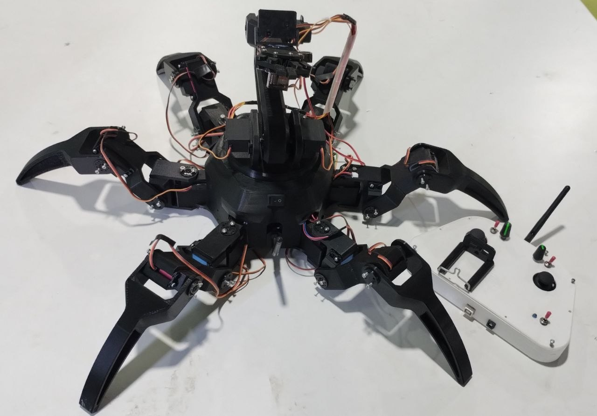

[Hardware](docs/HARDWARE.md) · [Power system](docs/power.md) · [Controls](docs/CONTROL.md) 

---

## Why I built it

Mines, nuclear power plants, pipe-filled industrial spaces, collapsed buildings in a rescue
mission: they have the same problem for a robot. The floor is cluttered with pipes, cables, rubble and steps, and a wheeled robot gets
stopped by the first obstacle. Legs can step over things, and an arm lets the robot do
something once it gets there: move debris, press, pick up and carry a light object.

<!-- Add: link to demo video -->
**Demo video:** https://www.instagram.com/reel/DaDLhgQxw-o/?exln=ZTF6NHNwNGUyenFh

## Design Inspiration

The robot is designed around one central idea: combine animal-inspired locomotion, stability on difficult terrain, and manipulation capabilities in a single platform, The base hexapod and manipulator structure is adapted from the open-source design by Emre Kalem.

**Crab-inspired morphology:**  The wide, laterally distributed leg arrangement takes inspiration from crabs and provides a broad support base. This geometry is useful for navigating cluttered terrain where wheel-based mobility can become restrictive. The current platform uses forward walking, while sideways crab locomotion remains a future extension.

**Insect-inspired locomotion:**  The robot uses an alternating tripod gait, inspired by the walking patterns of insects such as ants and cockroaches. Legs 0, 2 and 4 alternate with legs 1, 3 and 5, creating alternating three-leg support phases for coordinated movement.

**Integrated manipulation:**  Unlike a conventional hexapod, this platform carries a robotic arm and gripper on its upper body. The legs handle terrain traversal while the arm enables object interaction. The arm folds over the chassis during locomotion to maintain a compact configuration.
### References 

1. **Chen, Y. et al. (2022).** [Sideways crab-walking is faster and more efficient than forward walking for a hexapod robot.](https://doi.org/10.1088/1748-3190/ac6847) *Bioinspiration & Biomimetics, 17(4).*

2. **Full, R. J. & Tu, M. S. (1990).** [Mechanics of six-legged runners.](https://doi.org/10.1242/jeb.148.1.129) *Journal of Experimental Biology, 148, 129–146.*

3. **Ting, L. H., Blickhan, R. & Full, R. J. (1994).** [Dynamic and static stability in hexapedal runners.](https://doi.org/10.1242/jeb.197.1.251) *Journal of Experimental Biology, 197, 251–269.*

4. **Mahapatra, A., Roy, S. S. & Pratihar, D. K. (2019).** [Study on feet forces' distributions, energy consumption and dynamic stability measure of hexapod robot during crab walking.](https://doi.org/10.1016/j.apm.2018.09.015) *Applied Mathematical Modelling, 65, 717–744.*

5. **Zheng, Y. et al. (2022).** [Different manipulation mode analysis of a radial symmetrical hexapod robot with leg–arm integration.](https://doi.org/10.1007/s11465-021-0664-0) *Frontiers of Mechanical Engineering, 17, Article 8.*
## Specifications

| | |
|---|---|
| Legs | 6 legs x 3 joints (coxa, femur, tibia), 18 x DS3235 Pro 35 kg.cm coreless metal-gear digital servos, 180 deg, 7.4 V |
| Arm | base, shoulder (2 servos), elbow, 2 wrist joints, gripper. 4 x MG996R (base, shoulder, elbow) and 3 x MG90 (wrists, gripper) |
| Main controller | Arduino Mega 2560 |
| Remote | Arduino Uno, 2 joysticks, 2 pots, toggles, 16x2 LCD, nRF24L01 |
| Camera | ESP32-CAM, MJPEG over its own WiFi network |
| Edge payload | UNIHIKER K10: camera, screen, temperature, humidity, light, accelerometer |
| Body tilt | K10 accelerometer (3-axis), used for tilt warning. |
| Power | 3S LiPo, 5200 mAh (11.1 V nominal, 12.6 V full). Three regulated rails: legs 7.4 V, arm 6.0 V, logic 5 V. See [docs/power.md] |
| Firmware | Arduino C++ (PlatformIO), MicroPython on the K10 |

## Build

<!-- Replace each image and write a caption in your own words. Add rows if you like. -->

| | | |
|---|---|---|
| 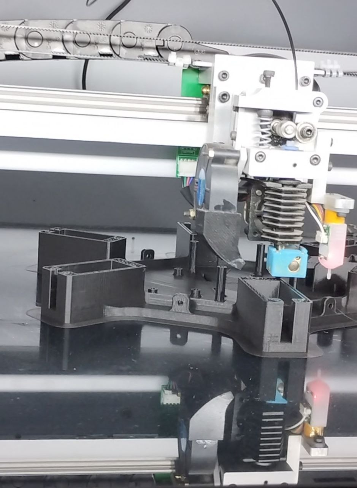 | 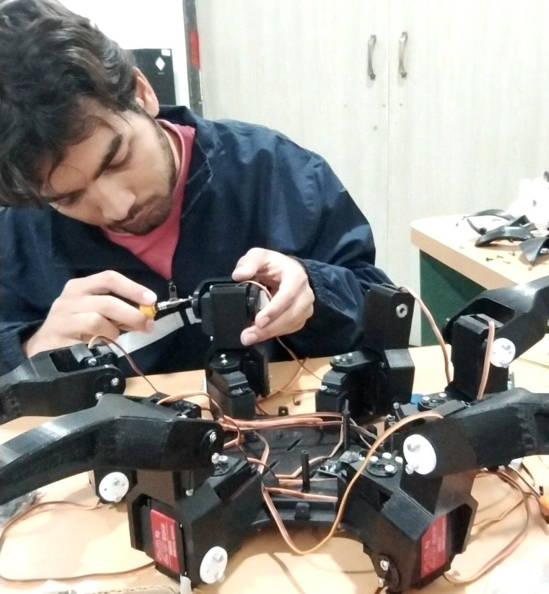 | 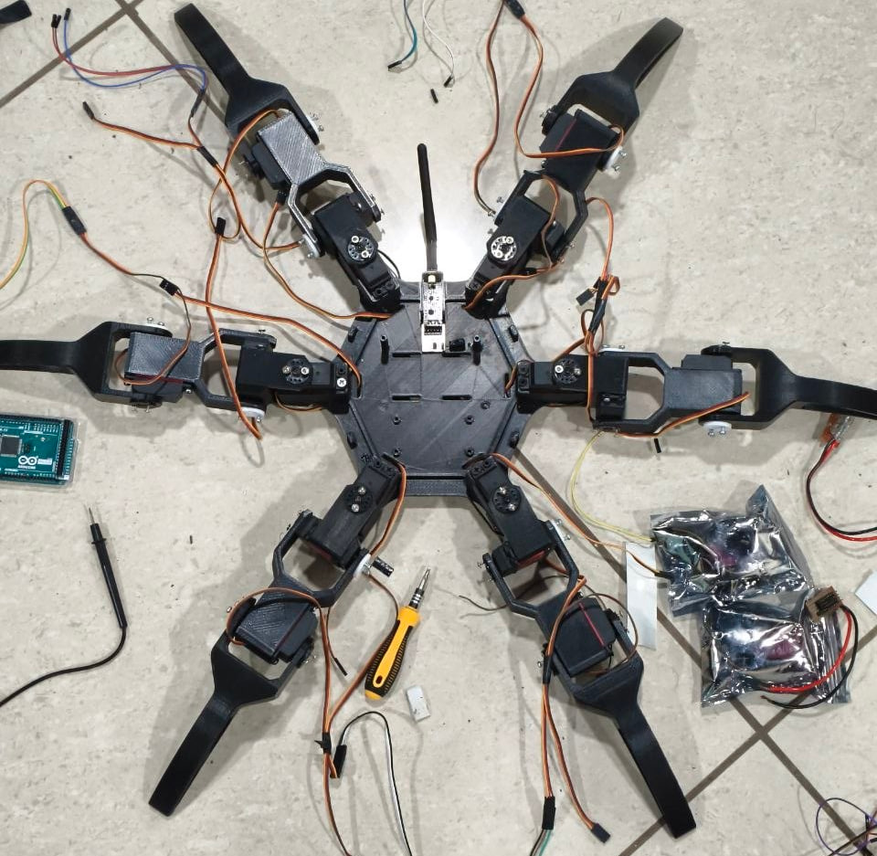 |
| _Printing_ | _Leg assembly_ | _Body_ |
| 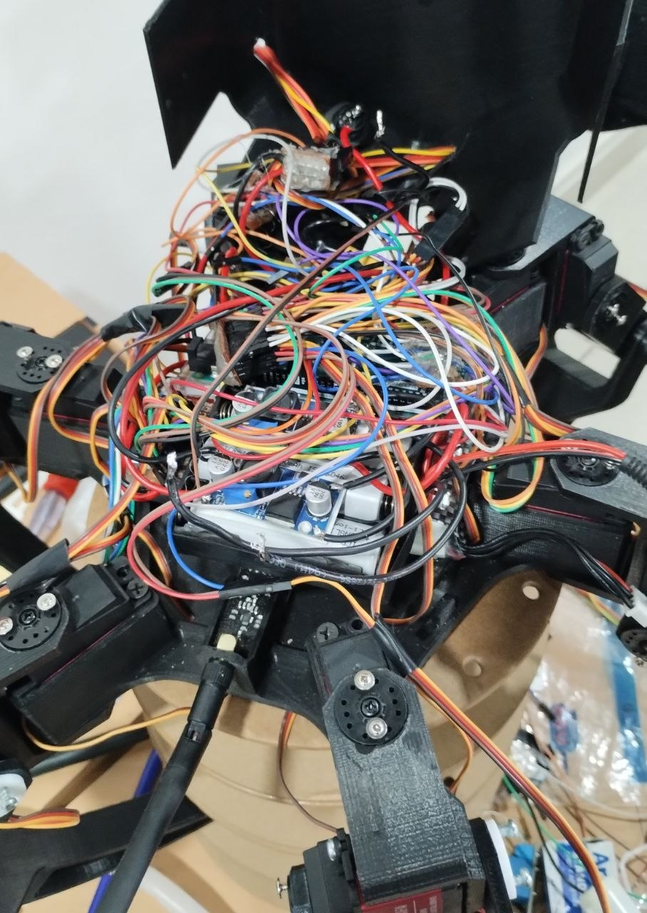 | 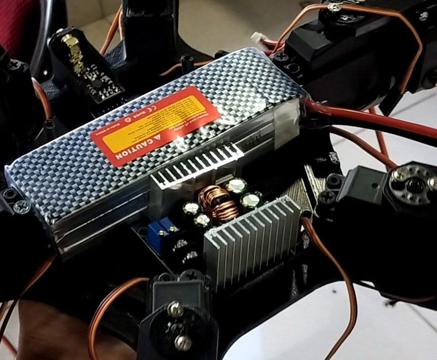 | 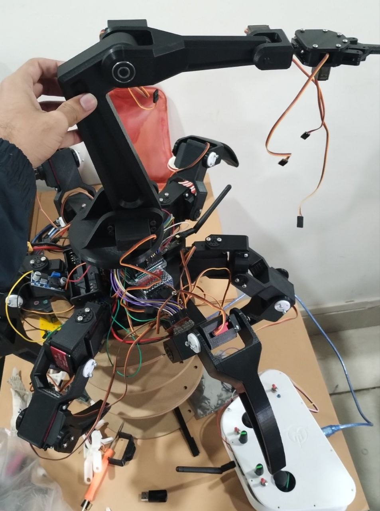 |
| _Wiring_ | _Power system_ | _Arm mounted on the body_ |
| 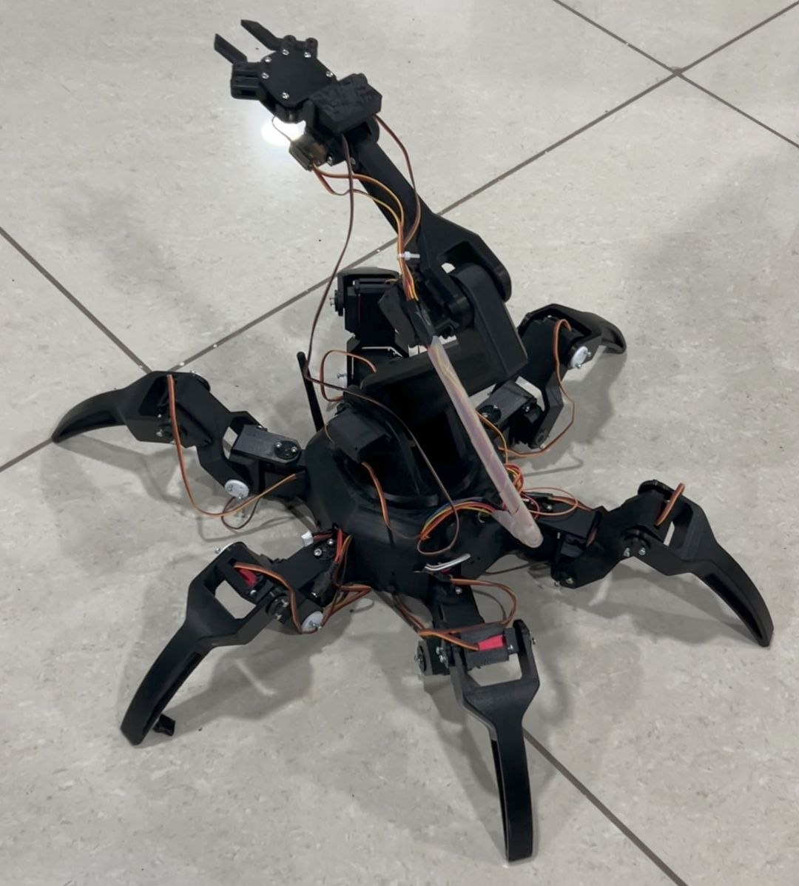 | 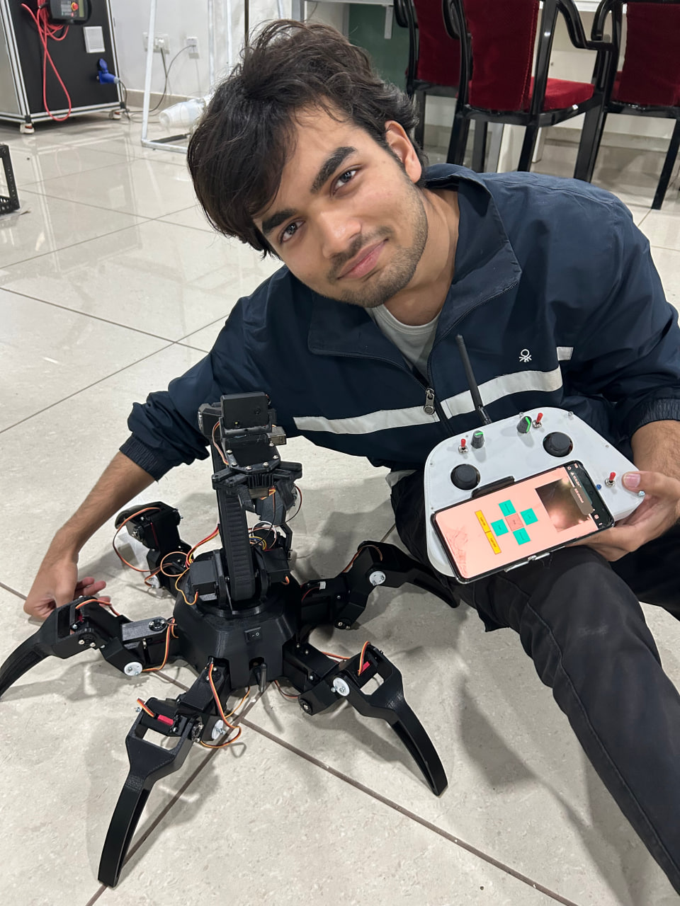 | 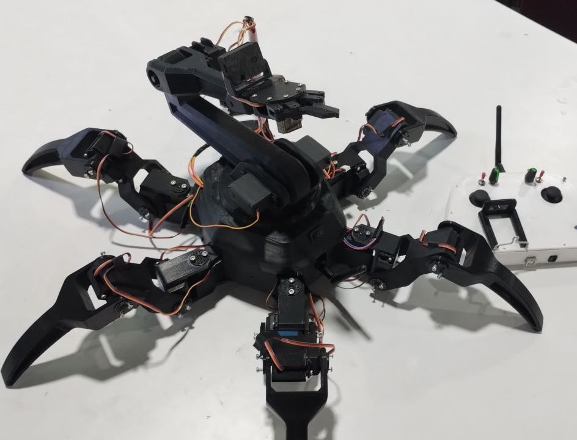 |
| _Finished robot_ | _Testing_ | _Close-up_ |

## System Architecture

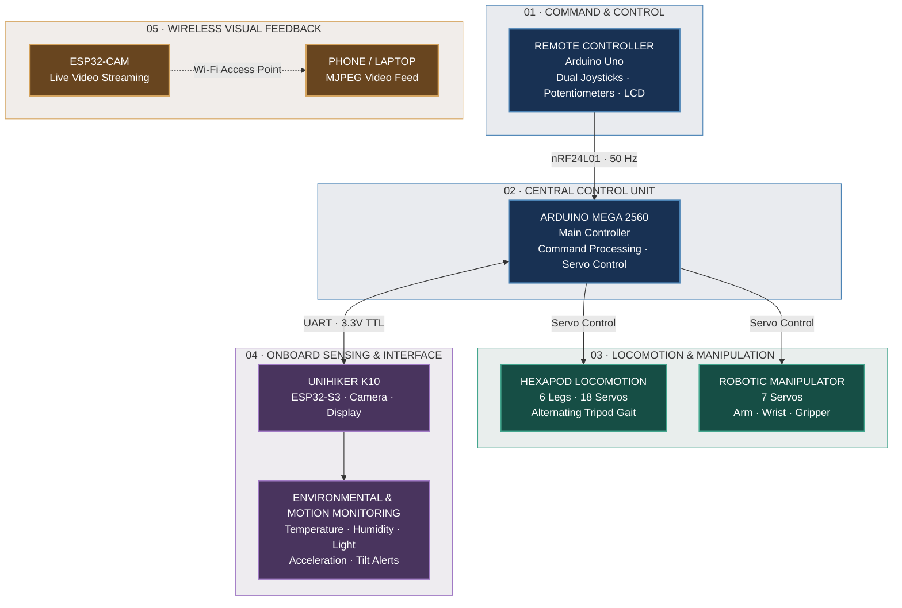

## Limitations

- Walking is open loop. The K10's accelerometer is used for tilt warning only. With no gyroscope
  there is no sensor fusion and no body leveling yet.
- Video goes over WiFi and has much shorter range than the control link.
- Radiation, dust and water are not addressed. Real nuclear or mine work would need a
  hardened, sealed machine.

