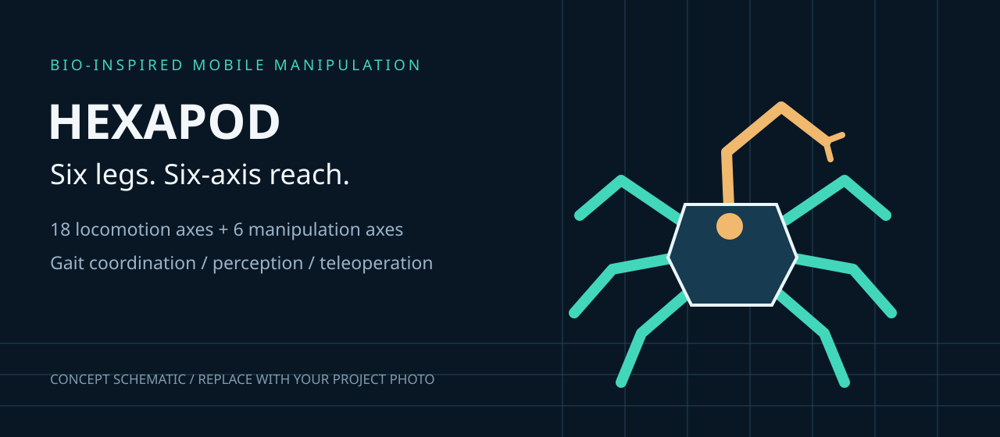
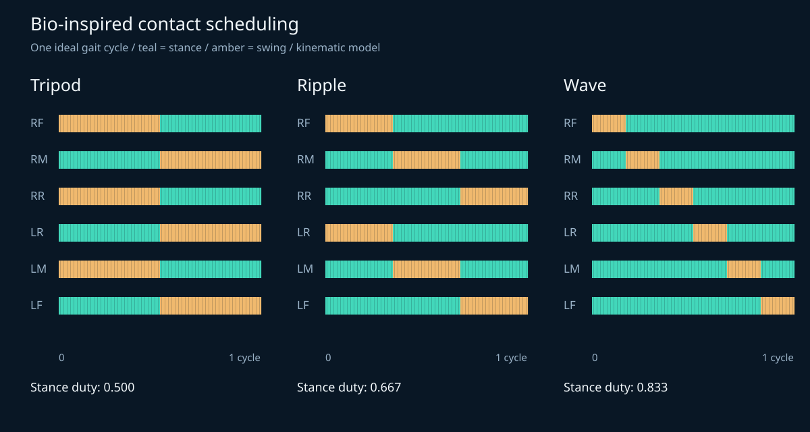
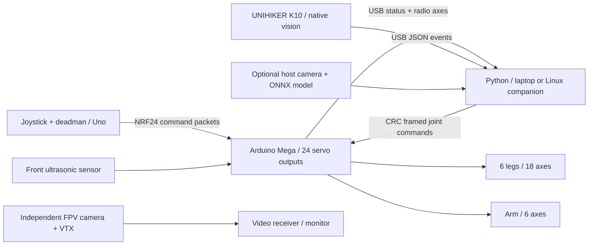

# Hexapod Robot with a 6-DOF Manipulator
### A bio-inspired platform for coordinated locomotion and target-directed interaction



**18 leg joints · 6 revolute arm joints · tripod / ripple / wave · Arduino Mega + Python**

[Quick start](#quick-start) · [Hardware](docs/HARDWARE.md) · [Control design](docs/CONTROL.md) · [Vision](docs/VISION.md) · [Experiments](docs/EXPERIMENTS.md) · [Add photos & video](media/README.md)

> **Project status:** runnable software reference and proposed hardware integration,
> derived from an attributed Arduino hexapod sketch. Leg geometry is source-backed;
> the arm dimensions, calibration and integration are design assumptions. Physical
> performance, terrain adaptation, AI accuracy, FPV latency and 1000–1200 m radio
> operation have not been established by this release. Add your measured evidence
> before presenting those capabilities as completed results.

## Motivation

Insects coordinate multiple legs to trade walking speed for a wider support base.
This project uses that principle to explore a practical question: **how can a
legged robot maintain useful support while positioning a tool to interact with
its environment?** A modular hexapod body provides six distributed contact points;
a separate six-axis arm adds task-directed reach without redesigning the legs.

The intended use is a small research and education platform for inspection,
remote exploration and light object interaction in spaces where wheel access is
limited. It is a basis for studying morphology, gait scheduling and mobile
manipulation; assistive applications are a future research direction, not a
clinical capability.

## What the code provides

| Subsystem | Implementation | Evidence / limit |
|---|---|---|
| Body geometry | Analytic FK/IK for six 3-joint legs | Dimensions and mount positions from supplied sketch |
| Bio-inspired gait coordination | Python tripod, paired ripple and sequential wave trajectories | Kinematic simulation; flat-ground open-loop control |
| Manipulator | Six revolute joints, numerical position and orientation IK, bounded motion | Proposed link geometry; no physical arm calibration |
| Vision | K10 native QR and cat/dog demo; host post-NMS ONNX inference | No custom model weights or measured accuracy supplied |
| Perception-to-action | QR label → surveyed target; calibrated pixel ray → planar target; arm IK | Stationary base only; no depth sensor or automatic grasping |
| Teleoperation | 50 Hz NRF24 joystick transmitter; Mega receiver; host gait control | CRC, deadman, host/radio timeouts; range unmeasured |
| Obstacle awareness | Front ultrasonic range inhibits motion below 250 mm or on timeout | Single direction only; not terrain sensing or avoidance planning |
| FPV | Separate video-link wiring plan and receiver preview / recording tool | Video does not travel over NRF24; hardware and latency unverified |
| Reproducibility | Unit/integration tests, configuration, CI, CSV traces and trial templates | See [validation record](docs/VALIDATION.md) |

**DOF convention:** 24 independently commanded revolute joints = 18 body + 6 arm.
The six arm joints are base yaw, shoulder pitch, elbow pitch, wrist roll, wrist
pitch and tool roll. An active gripper would be a **25th actuator**, or would
replace one arm axis and change the stated pose DOF. This release models a passive
tool / contact probe; it does not claim an implemented grasp-and-release mechanism.



## System architecture



The Python controller runs on a laptop or additional Linux companion, **not on
the K10**. K10 runs vendor MicroPython for native vision. Untethered operation
therefore needs an onboard host and suitable USB/power connections. The original
Arduino-only walking sketch is preserved as a source-text snapshot in `reference/` for provenance;
it uses a different radio protocol and is not the integrated firmware.

## Quick start

Use Python 3.10 or newer, from the extracted project directory:

```bash
python3 -m venv .venv
source .venv/bin/activate
python -m pip install -e .
python -m unittest discover -s tests -v
hexapod simulate --gait tripod --seconds 10 --output logs/tripod.csv
hexapod simulate --gait ripple --seconds 10 --output logs/ripple.csv
hexapod simulate --gait wave --seconds 10 --output logs/wave.csv
hexapod arm-demo --target 220 20 150
python tools/summarize_run.py logs/wave.csv
```

Windows PowerShell: activate with `.venv\Scripts\Activate.ps1`.
Simulation generates 24 servo commands and an ideal support-polygon margin in CSV;
it does not simulate contact forces, motor torque, slipping or a real camera.
Arm demo prints the target, achieved position, joint angles and position error.

### Hardware bring-up

Follow [wiring and calibration](docs/HARDWARE.md) before powering actuators.
Install optional host dependencies and PlatformIO, then compile:

```bash
python -m pip install -e '.[hardware,vision]' platformio==6.1.18
pio run --project-dir firmware/receiver
pio run --project-dir firmware/transmitter
# Upload only after checking wiring, board selection and calibration:
pio run --project-dir firmware/receiver --target upload
pio run --project-dir firmware/transmitter --target upload
```

Set measured servo offsets/signs/limits in `config/robot.json` and matching firmware
limits. Only after supported single-joint calibration, change both the JSON
`hardware_calibrated` flag and receiver `HARDWARE_CALIBRATED` constant to true.
Rebuild/upload the receiver. Restore the NC stop loop; release the transmitter
deadman and physical enable, then launch:

```bash
hexapod run --port /dev/ttyACM0 --enable-motion --seconds 30
# Add native K10 target events only after target coordinates are surveyed:
hexapod run --port /dev/ttyACM0 --vision-port /dev/ttyACM1 \
  --enable-motion --allow-vision-targets --seconds 30
```

Replace device paths with yours. Hold the receiver enable and transmitter deadman
to permit motion. A fresh valid host frame, radio command, intact stop loop and
clear front range are all required. A missing range sensor inhibits output.
The robot must be supported and pre-positioned before enabling; hobby servos do
not report their actual starting angle. Loss of output detaches servos and can
remove holding torque. Use a physical servo-power emergency switch.

## Research questions

- **Morphology and fabrication:** how do leg dimensions, mounting geometry and
  arm placement change workspace and the ideal support region?
- **Locomotion tradeoffs:** how do tripod, ripple and wave schedules affect speed,
  body motion, energy per metre and contact reliability?
- **Manipulation and balance:** how does arm extension shift the combined centre
  of mass, and when should the base stop or widen its stance?
- **Perception-guided interaction:** what calibration and uncertainty limits are
  needed before a detected target can produce a reliable tool approach?

These questions connect the platform to computational robot design, robust
manipulation and gait/balance control. They are future experiments, not results
or claims of affiliation. [Research positioning](docs/RESEARCH_POSITIONING.md)
explains the connections to CREATE, LASA and REHAssist using their public topics.

## Project map

```text
config/robot.json             Geometry, assumed arm, calibration and control limits
src/hexapod/                  FK/IK, gaits, arm, protocol, vision and controller
firmware/receiver/            Mega servo receiver, radio bridge and range interlock
firmware/transmitter/         Uno joystick / deadman / gait selector
edge/k10/main.py              Native MicroPython vision event producer
tests/                       Kinematic, protocol and controller checks
tools/                       FPV receiver preview and CSV summary
docs/                        Wiring, design, vision, experiments and provenance
experiments/                 Blank field data template
examples/                    Example event messages
media/                       Replaceable schematic and media instructions
reference/                   Supplied MIT Arduino source-text snapshot
.github/workflows/           Python checks and firmware build jobs
```

## Demonstration and results

**Photo:** replace the schematic above with `media/robot.jpg`.
**Video:** add your hosted demonstration link here after uploading footage.
See [media instructions](media/README.md) for a suggested sequence.

| Metric | Result |
|---|---|
| Physical walking speed / terrain success | Not measured |
| Arm payload / reach accuracy / repeatability | Not measured |
| K10 inference FPS / classification accuracy | Not measured |
| Reliable radio distance / packet delivery | Not measured; 1000–1200 m is a validation target |
| FPV end-to-end latency | Not measured |
| Battery runtime / energy per metre | Not measured |

Populate these entries with dated trials and videos. [Experiment protocols](docs/EXPERIMENTS.md)
include packet delivery, video latency, gait comparisons and arm error measurement.

## Attribution and license

The supplied `Hexapod_Arduino.ino` credits **Özgür Toprak Önsoy and Emre Kalem**
(November 2025, Eskişehir, Türkiye) and carries the MIT license, copyright 2025
Emre Kalem. This release preserves that file and notice. Leg dimensions, mount
positions, pin order and the baseline FK/IK convention informed the new modules.
The Python stack, new receiver/transmitter, proposed arm and documentation are
additions; do not present the reference code as your original authorship.
See [THIRD_PARTY_NOTICES.md](THIRD_PARTY_NOTICES.md), [provenance](docs/PROVENANCE.md)
and [LICENSE](LICENSE).
