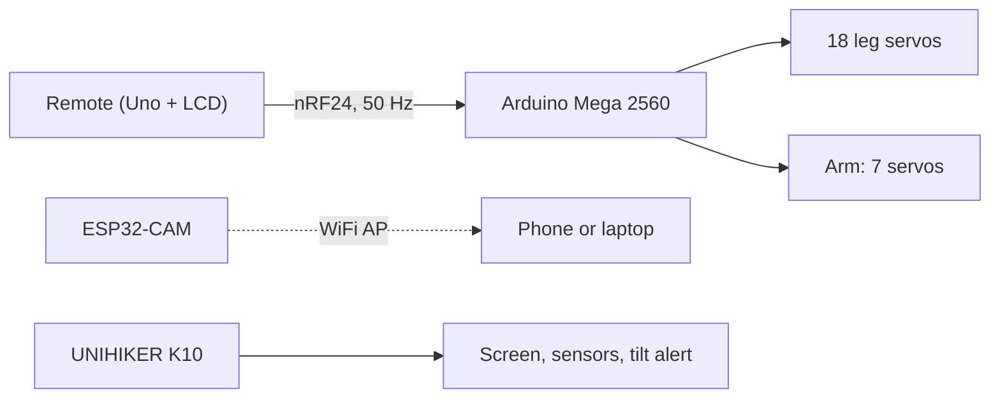

# Hexapod Mobile Manipulator

**A six-legged robot with an arm, built for places where wheels don't work and people shouldn't go.**

18 leg servos · arm with gripper · remote control with live video · onboard sensing

<!-- HERO: best photo of the finished robot, or a GIF of it walking -->

[Hardware](docs/hardware.md) · [Power system](docs/power.md) · [Controls](docs/controls.md) · [Performance](docs/performance.md) · [Credits](NOTICE.md)

---

## Why I built it

Mines, nuclear power plants, pipe-filled industrial spaces, collapsed buildings in a rescue
mission: they have the same problem for a robot. The floor is cluttered with pipes, cables, rubble and steps, and a wheeled robot gets
stopped by the first obstacle. Legs can step over things, and an arm lets the robot do
something once it gets there: move debris, press, pick up and carry a light object.

<!-- Add: link to demo video -->
**Demo video:** _add link_

## Design inspiration

Each part of the design borrows something from an animal, for a specific reason.

**Spider: low and wide.** Spiders keep their body low with legs sprawled out. A low centre of
mass and a wide footprint make uneven ground much less likely to tip them. The hexapod
stands low (programmed 40 mm stance height) on a wide leg layout for the same reason.
(Spiders have eight legs. The idea borrowed is the stance.)

**Insects: three feet always down.** Ants and cockroaches walk in a tripod gait: three legs
on the ground while the other three swing forward, then swap. The body is always supported
by a stable triangle. The robot's gait is the same, with alternate legs half a cycle apart.

**Scorpion: tool carried over the back.** A scorpion arches its tail over its back and grips
with its pincers. The robot's arm is mounted on the top of the body, folded back out of the
way while walking, with a gripper at the end. The legs never carry the arm's load directly.

**Ants and beetles: carrying with the mouth, not the legs.** Ants carry food and debris in
their mandibles while they keep walking on six legs, and beetles use mandibles and horns to
grip and lift. The legs stay busy with walking, and the front end handles the load. The robot
splits the work the same way: legs for locomotion, arm and gripper for carrying.

## Specifications

| | |
|---|---|
| Legs | 6 legs x 3 joints (coxa, femur, tibia), 18 x DS3235 Pro 35 kg.cm coreless metal-gear digital servos, 180 deg, 7.4 V |
| Arm | base, shoulder (2 servos), elbow, 2 wrist joints, gripper. 4 x MG996R (base, shoulder, elbow) and 3 x MG90 (wrists, gripper) |
| Main controller | Arduino Mega 2560 |
| Remote | Arduino Uno, 2 joysticks, 2 pots, toggles, 16x2 LCD, nRF24L01 |
| Camera | ESP32-CAM, MJPEG over its own WiFi network |
| Edge payload | UNIHIKER K10: camera, screen, temperature, humidity, light, accelerometer |
| Body tilt | K10 accelerometer (3-axis), used for tilt warning. The K10 has no gyroscope |
| Power | 3S LiPo, 5200 mAh (11.1 V nominal, 12.6 V full). Three regulated rails: legs 7.4 V, arm 6.0 V, logic 5 V. See [docs/power.md](docs/power.md) |
| Firmware | Arduino C++ (PlatformIO), MicroPython on the K10 |

## Performance

Design values come from the geometry and constants in the code. Measured values are filled in
from tests; test methods are in [docs/performance.md](docs/performance.md).

| Metric | Design value | Measured |
|--------|--------------|----------|
| Leg reach (coxa + femur + tibia) | 284.75 mm | |
| Stance height | 40 mm | |
| Foot lift per step | 100 mm | |
| Stride per gait cycle | 60 mm | |
| Femur servo torque, standing | about 5.8 kg.cm per kg of robot (tripod load, home pose) | |
| Walking speed | about 35-60 mm/s (stride / cycle time, no slip) | |
| Control rate, link | 50 Hz, 250 kbps | |
| Link-loss stop | 500 ms | |
| Control range | | |
| Battery runtime | 46 Wh usable: about 35-70 min at 80-40 W average draw (planning figure) | |
| Gripper payload | | |
| Video latency | | |
| Step / pipe height | | |

## Build

<!-- Replace each image and write a caption in your own words. Add rows if you like. -->

| | | |
|---|---|---|
|  |  |  |
| _Printing_ | _Leg assembly_ | _Body_ |
|  |  |  |
| _Wiring_ | _Power system_ | _Arm mounted on the body_ |
|  |  |  |
| _Finished robot_ | _Testing_ | _Close-up_ |

## How it works

**Control.** The remote sends a packet 50 times a second. Toggle 1 picks the mode. In walk
mode the joysticks drive the gait and the arm holds its pose. In arm mode the joysticks move
arm joints, the pots set the wrist and gripper, and the legs stand. If no packet arrives for
half a second, the robot stands still and the arm holds.

**Gait.** Tripod gait. Each foot target goes through inverse kinematics on the Mega to get
the coxa, femur and tibia angles.

**Power.** The battery never touches a servo or a board directly. The 3S pack feeds a 7.4 V leg rail
(two converters, left and right), a 6.0 V arm rail (the highest voltage both MG90 and MG996R
accept) and a 5 V logic rail, all behind a fuse and a master switch. Details and sizing in [docs/power.md](docs/power.md).

**2.4 GHz.** The control link and the camera share the band, so the nRF24 runs on channel
76 and the camera's WiFi is pinned to channel 1. They don't overlap.

## Limitations

- Walking is open loop. The K10's accelerometer is used for tilt warning only. With no gyroscope
  there is no sensor fusion and no body leveling yet.
- Video goes over WiFi and has much shorter range than the control link.
- Radiation, dust and water are not addressed. Real nuclear or mine work would need a
  hardened, sealed machine.
- Runtime, payload and arm accuracy are not measured yet.

## Next

- Add a gyro (external IMU) and use it with the accelerometer to level the body on uneven ground.
- Run the K10's built-in vision models (QR code, face, motion) on the robot.
- Ripple and wave gaits, compared with the tripod on speed and stability.
- Test over pipes and steps, and measure the height it can cross.

Built by Divyansh Rahangdale.

The base hexapod design and its gait and kinematics are open source, by Emre Kalem and
Ozgur Toprak Onsoy (MIT). Other sources are listed in [NOTICE.md](NOTICE.md).
